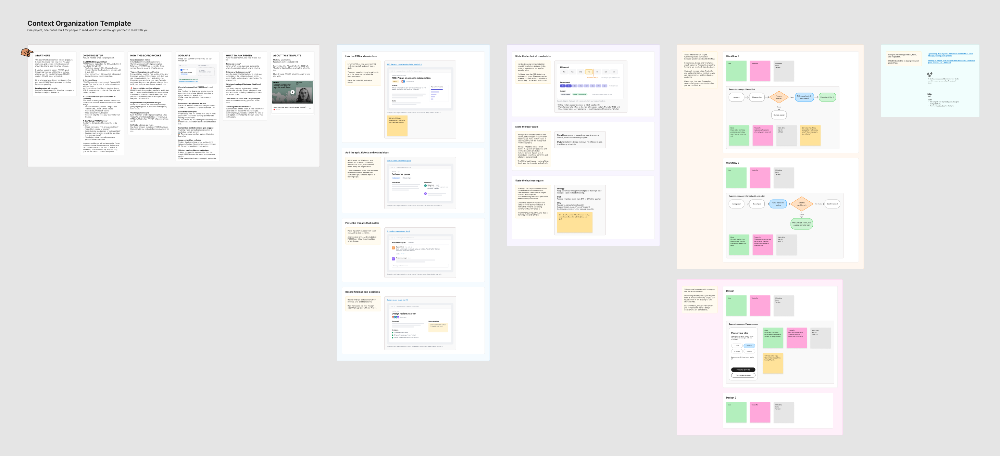
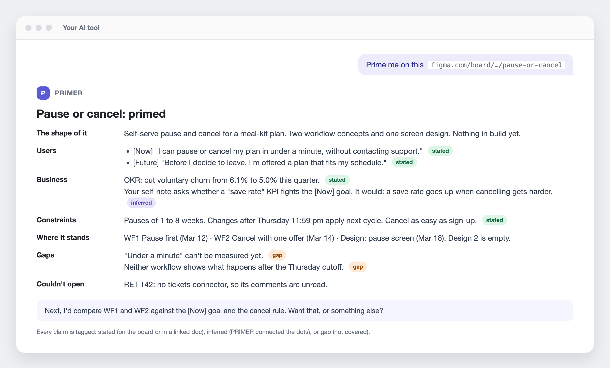
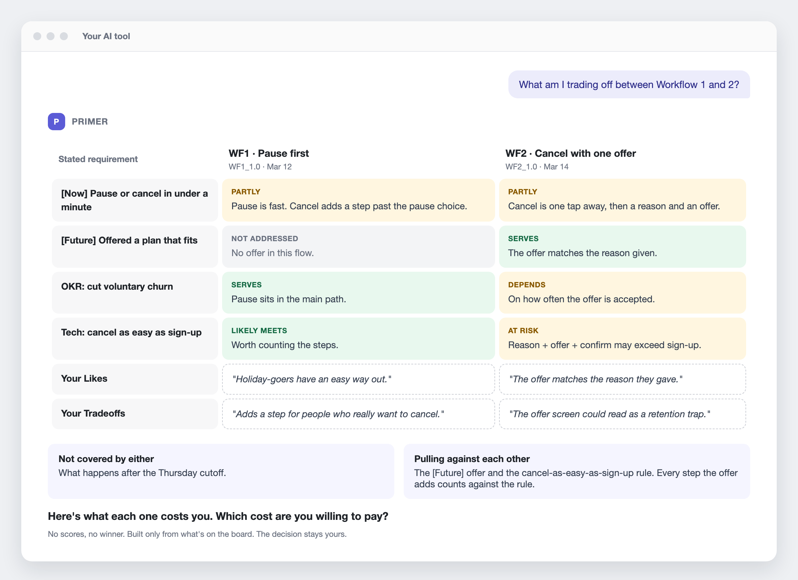
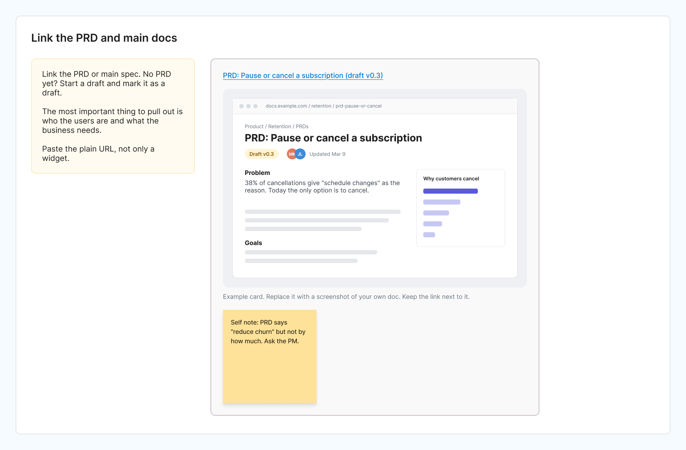
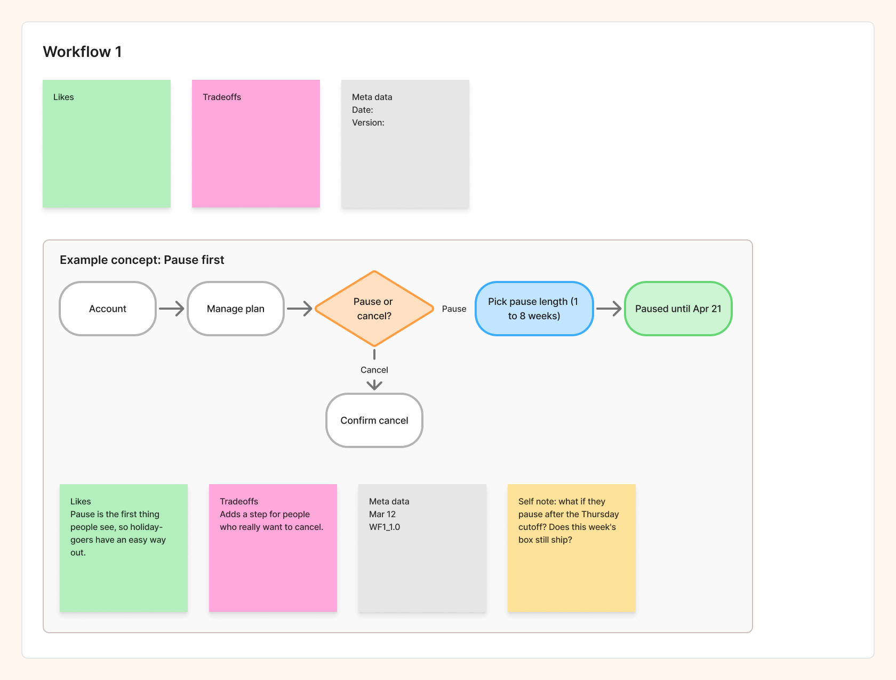

# PRIMER for FigJam boards (`primer-board`)

**A FigJam context board for your project, and an AI thought partner that reads it with you.**

Design projects end up scattered: a PRD in one tool, tickets in another, decisions in a chat thread, half-formed concepts in your head. The **Context Organization Template** puts all of it on one FigJam board, built for people first. Your PM, your engineers, and anyone reviewing the work can read it in a few minutes.

**PRIMER** is the second reader. It's a single instruction file (`SKILL.md`) you add to the AI tool you already use. It reads the board and the docs it links to, then:

- **Primes you**: a short brief of users, business goals, constraints, where the concepts stand, and what's missing.
- **Helps you write goals**: asks the questions that turn a feature into a real user goal, and points at evidence already on the board.
- **Shows the tradeoff**: lays every concept against every stated requirement, visually.

Two things it won't do: **write on your board**, or **pick your design**. It shows what each option costs and hands the decision back. That part is yours.

### What you get

**"Prime me on this"**: a short brief, with every claim tagged as stated, inferred, or a gap.

**"What am I trading off between Workflow 1 and 2?"**: each concept against each stated requirement, with your own Likes and Tradeoffs alongside. No scores, no winner.

### What the board looks like up close

Every area has yellow **Tips** and a gray **Examples** section with editable example cards. PRIMER skips both, so you can leave them in while you work.

## Get started

1. **Duplicate the FigJam template**: [Context Organization Template](<!-- TODO: Figma Community link -->)
2. **Add PRIMER to your AI tool** (see below).
3. **Connect Figma** to your AI tool through [Figma's MCP server](https://developers.figma.com/docs/figma-mcp-server/).
4. Say **"Set up PRIMER for me"**. It asks five quick questions about how you like to be briefed, and remembers the answers.
5. Paste your board's link and say **"Prime me on this"**.

## Add PRIMER to your AI tool

| Your tool | How |
|---|---|
| **Tools that support skills** (Claude, Codex, Cursor, Gemini CLI, GitHub Copilot, and others that read `SKILL.md`) | Copy the `primer-board/` folder into your tool's skills folder. For Claude Code that's `~/.claude/skills/primer-board/`. In the Claude apps, upload the folder as a `.zip` custom skill. Other tools: see their skills docs |
| **Chat tools without skills** | Paste the contents of `primer-board/SKILL.md` into a project's instructions or a custom assistant |

`SKILL.md` stands alone. `references/connector-tips.md` is optional extra help for specific connectors. The skill is named `primer-board` so it won't clash with any other skill called `primer` you may already have.

## What you need

- **A Figma connection** for the best results. PRIMER reads the board through Figma's MCP server (`use_figma`). No connection? Attach a PDF or screenshots of the board instead. The brief will be less detailed.
- **Mind the Figma rate limits.** View and Collab seats, and Starter plans, get about 20 Figma MCP calls a month. Full and Dev seats on paid plans get far more. PRIMER reads a board in one or two calls. See [Figma's rate limits](https://developers.figma.com/docs/figma-mcp-server/rate-limits-access/).
- **Optional connectors** for the tools your board links to (docs, tickets, chat, files). Without them, PRIMER can see that a PRD exists but not what it says, and it will tell you which links it couldn't open.

## Gotchas

The template's Initial Setup section has the full list. The big ones:

- **Widgets look good, but PRIMER can't read them.** Jira, Confluence, and similar widgets keep their data private. Paste the plain URL next to each one.
- **Screenshots are pictures.** Put the link or a one-line note next to them.
- **Anything inside an Examples section is skipped.** Move your real content out.

## Credits

- Made by **[Billy So](https://www.linkedin.com/in/billyso/)**.
- Inspired by Jake Albaugh's Config 2026 talk, [Figma deep dive: Agentic workflows and the MCP](https://www.youtube.com/watch?v=D5WUW9X_-L0). Thanks to [Sabrina Chan](https://www.linkedin.com/in/sabrinacly/) for sharing it.
- "Do the fun parts yourself" comes from Adir SL, [Battling AI fatigue as a designer and developer](https://uxdesign.cc/battling-ai-fatigue-as-a-designer-and-developer-a-practical-guide-d04a2549e802).

## License

© 2026 Billy So. Licensed under [Creative Commons Attribution 4.0 International (CC BY 4.0)](https://creativecommons.org/licenses/by/4.0/), the same license as the FigJam template on Figma Community. You can share and adapt PRIMER, including commercially, as long as you credit Billy So and link back to this repo. Full text in [LICENSE](LICENSE).
